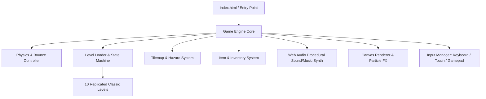

# BUMPY - Modern Arcade Web Replica: Knowledge Base

**Project Root:** `d:\Projects\bumpy`  
**Last Updated:** 2026-11-07  
**Status:** Active Development  

---

## 1. Executive Summary & Architecture Overview

### 1.1 Project Overview
A modern, browser-based replica of the classic 1989/1992 arcade puzzle-platformer **Bumpy** (originally by Loriciels). The player controls Bumpy, an expressive, continuously bouncing character, navigating single-screen puzzle arenas. To finish each stage, Bumpy must bounce across varied terrain, collect all required items, and reach the unlocked Exit Door while avoiding hazards and solving puzzle mechanics (crumbling blocks, fire & water droplets, hammers, ice, teleporters, springs, conveyors, and locked doors).

### 1.2 Tech Stack
- **Runtime / Bundler:** Vite + TypeScript + HTML5 Canvas 2D / WebGL
- **Audio:** Web Audio API procedural chiptune synth engine (retro boings, chimes, explosions, fanfares, and multi-track arcade background music)
- **Controls:** Keyboard (Arrows / WASD, Space), Touch / On-screen controls for mobile/tablet, and Gamepad API support
- **State & Storage:** LocalStorage for high scores, unlocked levels, star ratings, and sound preferences
- **Zero Heavy Dependencies:** Ultra-fast loading, standalone browser bundle without bulky game engines, ensuring snappy 60 FPS physics and maximum portability.

### 1.3 High-Level Architecture Flow


---

## 2. Key Decisions & Rationale

| Decision | Alternatives Evaluated | Rationale |
|---|---|---|
| **Vite + TypeScript + Canvas 2D** | Phaser 3, PixiJS, Vanilla JS | Ultra-lightweight, zero bundle bloat, direct sub-millisecond physics loop, full control over squash-and-stretch rendering and retro pixel feel. |
| **Procedural Web Audio Synth** | Pre-rendered MP3/WAV assets | Zero external asset loading failures, instant zero-latency playback, authentic 8-bit/16-bit chiptune sound generation, fully configurable music and SFX. |
| **Grid-based Hybrid Continuous Physics** | Strict discrete tile-stepping vs. Pure rigid body (Box2D) | Classic Bumpy combines continuous vertical bouncy trajectory with discrete grid tile interactions (breakable blocks, fire dousing, hammer striking). Continuous custom Euler physics accurately replicates the classic bounce feel with modern responsiveness. |
| **10 Authored Puzzle Levels** | Procedural generation | Faithfully recreates classic Bumpy level progression, steadily introducing mechanics: basic bounces -> crumbling tiles -> springs -> fire & water -> hammers -> ice -> portals -> conveyors -> complex puzzles. |

---

## 3. Environment, Infrastructure & Deployment

- **Node.js:** v24.18.0
- **NPM:** 11.16.0
- **GitHub Repository:** `https://github.com/eitamaath-design/bumpy`
- **Live Production URL:** `https://eitamaath-design.github.io/bumpy/`
- **Hosting Provider:** GitHub Pages (Automated via GitHub Actions `.github/workflows/deploy.yml`)
- **Dev Server Port:** Default Vite port `5173`
- **Target Browsers:** Modern evergreen browsers on Desktop and Mobile (Chrome, Edge, Firefox, Safari, iOS Safari, Android Chrome)
- **Mobile Optimizations:**
  - Responsive 4:3 canvas scaling with `touch-action: none` to prevent gestures and pinch-zoom interference.
  - Virtual On-Screen Gamepad: D-pad (Left, Right, Jump, Fast-fall) and high-bounce action button with haptic feedback vibration.
  - Dual-mode direct screen touch steering: tap left/right halves to move, tap top to high jump, tap bottom to dive.
  - Immediate Web Audio unlocking on first touch gesture.

---

## 4. Operations & Maintenance Runbook

### 4.1 Development
```bash
# Install dependencies
npm install

# Start local development server with hot module reload
npm run dev

# Type check and build production distribution
npm run build

# Preview production build locally
npm run preview
```

### 4.2 Key Controls
- **Arrow Keys / WASD:** Move Left / Right; Hold **UP / W** to execute High Bounce / Super Jump; Hold **DOWN / S** to fast-fall.
- **Space:** Alternate High Bounce trigger.
- **R:** Quick Level Restart.
- **M:** Toggle Music.
- **N:** Toggle Sound Effects.
- **P / Esc:** Pause Game.

---

## 5. Workspace Files & Entry Points

| File / Directory | Purpose |
|---|---|
| `package.json` | Project configuration, scripts, and dev dependencies |
| `vite.config.ts` | Vite bundler configuration |
| `index.html` | Single page application shell and canvas mount |
| `src/main.ts` | Application bootstrap and main loop initialization |
| `src/engine/Game.ts` | Central game loop, screen state router, time step management |
| `src/engine/Physics.ts` | Bumpy bouncy physics, squash/stretch deformation, collision resolution |
| `src/engine/Input.ts` | Input handler for keyboard, touch overlay, and gamepad |
| `src/engine/Audio.ts` | Web Audio API procedural sound effects & chiptune arcade music engine |
| `src/engine/Renderer.ts` | Canvas rendering, retro aesthetic, tile drawing, CRT scanline shader, HUD |
| `src/engine/Particles.ts` | Visual FX, crumble debris, fire steam, sparks, item score popups, confetti |
| `src/engine/Types.ts` | TypeScript interfaces, platform tile types, item definitions |
| `src/levels/levels.ts` | 10 handcrafted levels with tile layouts, items, hazards, and puzzle mechanics |
| `src/style.css` | Arcade cabinet styling, responsive scaling, touch controls |
